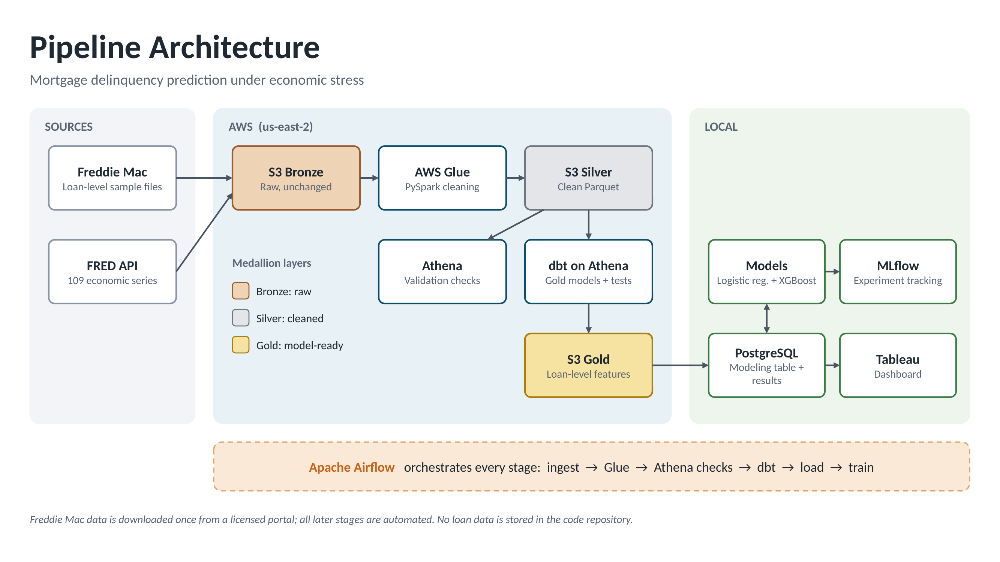

Mortgage Delinquency Prediction Under Economic Stress

M.S. Data Science Capstone, Houston Christian University (DSCI 5390) Author: Conrad Toke

An end to end data engineering and machine learning project that predicts mortgage delinquency from Freddie Mac loan level data and measures how model performance changes when economic conditions shift (the 2008 financial crisis and COVID-19).

Research question

How well does a delinquency model trained in one economic period perform in another, and does adding macroeconomic features make it more robust?

Target: a loan becomes 90+ days delinquent within 24 months of origination. A fixed 24 month window gives every loan the same chance to become delinquent, so loans from different years can be compared fairly.

Evaluation design: models are trained on earlier periods and tested on later ones (for example, trained on 2005-2006 loans and tested on 2007–2009 loans, and trained on 2013–2018 loans and tested on 2019–2021 loans). Each model is compared with and without economic indicators measured at origination. This tests real historical economic shifts rather than simulated scenarios.

Architecture

Why this split? The heavy data work runs in AWS which is about 56 million monthly loan records are cleaned with Spark in Glue and joined with dbt in Athena, where storage and compute scale with the data. Only the finished modeling table (about 900,000 loans) and the model results are loaded into PostgreSQL, where modeling and the dashboard run locally. This keeps processing fast and cheap while mirroring how lenders pair cloud processing with a curated warehouse.

Repository layout
config/          pipeline settings (non secret)
ingestion/       Bronze: Freddie Mac and FRED ingestion scripts
glue/            Silver: PySpark jobs (run locally or in AWS Glue)
infra/aws/       IAM roles and Glue jobs as code (run in AWS CloudShell)
sql/athena/      Athena table definitions and validation queries
dbt/             Gold models and data tests (dbt on Athena)
ml/              training, evaluation by time window, drift analysis
airflow/         Airflow DAG
notebooks/       data profiling and EDA
dashboard/       Tableau screenshots only (no data)
docs/            project log, diagrams, and write ups
tests/           unit tests

Data and licensing

Loan data comes from the Freddie Mac Single Family Loan Level Dataset (sample files, release 2026Q2), used under Freddie Mac's terms of use. No Freddie Mac data is stored in this repository. To reproduce, register with Freddie Mac and download the sample files yourself. Macroeconomic data comes from FRED, Federal Reserve Bank of St. Louis.

AWS environment

All AWS resources run in one AWS project account in us-east-2 (Ohio).

- Least privilege: the laptop pipeline user can read and write the project bucket only. It cannot create roles or change permissions. Admin tasks run in AWS CloudShell.
- Infrastructure as code: IAM roles and Glue jobs are created from scripts in infra/aws/, so the setup is documented, reviewable, and repeatable.
- Cost controls: a project spending cap, a per query Athena scan limit, and a 10 minute Glue job timeout.
- Security: public access is blocked on the bucket, objects are encrypted at rest, bucket versioning is on, and Athena query results are written to the project bucket with the expected owner verified.

Setup

bash
conda create -n capstone python=3.11 -y
conda activate capstone
pip install -r requirements.txt
conda install -c conda-forge openjdk=17 -y   # Java, required to run Spark locally
cp .env.example .env                          # then fill in your values
pytest -q                                     # confirm everything imports and passes

Step 1) Bronze ingestion

Bronze stores raw data exactly as received and is never modified.

FRED (API, fully automated). Pulls 109 series: 7 national (unemployment, CPI, federal funds rate, 30 year mortgage rate, real GDP, house price index, and the NBER recession indicator) plus unemployment and house prices for all 50 states and DC.

bash
python -m ingestion.fred_ingestion --local --national-only   # quick test, no AWS needed
python -m ingestion.fred_ingestion                            # full run to S3

Freddie Mac (licensed download, then automated upload). The dataset requires a login, so the 18 sample zip files (2005–2022) are downloaded once by hand into data/bronze/freddie_mac/, a local landing folder. The script then validates each file, records a checksum, and uploads it to S3.

bash
python -m ingestion.freddie_mac_ingestion --release 2026Q2 --dry-run   # validate first
python -m ingestion.freddie_mac_ingestion --release 2026Q2             # upload to S3

Bronze layout in S3:

bronze/fred/series_id=<ID>/ingest_date=<YYYY-MM-DD>/observations.json
bronze/freddie_mac/release=<YYYYQn>/origination/vintage=<YYYY>/sample_orig_<YYYY>.txt
bronze/freddie_mac/release=<YYYYQn>/performance/vintage=<YYYY>/sample_perf_<YYYY>.txt

Result: 145 objects (109 FRED series and 36 Freddie Mac files), about 6.5 GB, including roughly 56 million monthly loan performance records.

Data profiling

Before writing any cleaning code, the raw data was profiled (notebooks/01_fred_profiling.ipynb). Key findings for FRED:

- All 109 series share the same structure, so one script can clean all of them.
- Values and dates are stored as text, and the series ID appears only in the folder path.
- 53 series are missing one value, all in October 2025, when the Bureau of Labor Statistics canceled its employment and CPI reports during the federal government shutdown. These stay missing in Silver and are flagged, not filled.

Step 2) Silver (FRED)

The FRED Silver job (glue/fred_silver.py) turns raw FRED JSON into one clean table. It unpacks observations, converts types, flags missing values, labels each series, keeps the latest download, and runs quality checks before writing Parquet. The job stops without writing if any check fails.

Run locally (reads data/bronze/, writes data/silver/):

bash
python glue/fred_silver.py

Run in AWS Glue (one time setup, then run; from AWS CloudShell in infra/aws/):

bash
bash create_glue_role.sh        # IAM role for Glue (least privilege)
bash create_fred_silver_job.sh  # Glue 5.0 job pointing at scripts/glue/fred_silver.py
bash run_fred_silver_job.sh     # start the job and wait for the result

Deploy script changes with:

bash
aws s3 cp glue/fred_silver.py s3://<bucket>/scripts/glue/fred_silver.py

Query in Athena: create the table with sql/athena/fred_silver_table.sql, then validate with sql/athena/fred_silver_checks.sql.

Result: 24,676 rows across 109 series, 53 missing values (all October 2025), no duplicates. Row counts match between the local run and AWS.

Design decisions

Decision	                                                           Reason
Medallion layers (Bronze, Silver, Gold) 	Raw data is kept untouched, so any cleaning step can be rerun from the original
Bronze is never overwritten	                Uploads are checksummed. A changed file is refused rather than silently replaced
Freddie Mac partitioned by release	        The dataset is updated quarterly; each release is kept side by side for a full audit  
                                            trail
Manual Freddie Mac download	                The dataset requires a login, and scripting around it would be fragile and could 
                                            breach the terms of use
name=value folder structure	                Spark reads folder names as columns, so the series ID and dates come for free
Missing values stay null in Silver	        Silver records what the source published; any filling is a documented Gold decision
Quality checks stop the job	                Bad data never reaches downstream layers, and failures are visible to orchestration
One script for laptop and Glue	            The --BUCKET parameter switches between local folders and S3, so code is tested 
                                            locally before it runs in AWS
Least privilege access	                    The Glue role can read Bronze but not change it; the laptop user cannot change 
                                            permissions
Infrastructure as code	                    Roles and jobs are created from versioned scripts instead of console clicks
Gold built in Athena, not PostgreSQL	    Joining 56 million rows is faster and cheaper in Athena. PostgreSQL receives only the 
                                            finished modeling table
Feature selection on the training window only	Looking at test-period data when choosing features would leak information
Tableau instead of Power BI	                Power BI Desktop does not run on macOS
Airflow added after the manual pipeline works	Each stage runs with one command, can be rerun safely, keeps settings outside 
                                            code, and fails loudly, so wiring it into Airflow later needs no code changes

Project status

Stage	                                                        Status
Bronze ingestion (FRED, Freddie Mac)	                        Done
FRED profiling                                              	Done
Silver: FRED (Glue job + Athena validation)                 	Done
Freddie Mac profiling and Silver	                            In progress
Gold layer (dbt on Athena)                                  	Planned
Modeling, MLflow, and evaluation by time window	                Planned
Airflow orchestration	                                        Planned
Tableau dashboard	                                            Planned

Use of AI tools

AI coding assistants were used to help scaffold code and documentation. All analysis, interpretation, and written academic work are my own.