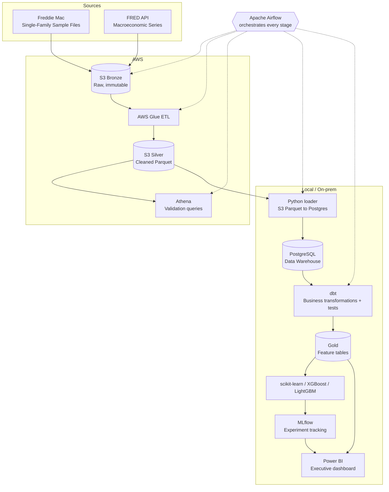

# Mortgage Delinquency Prediction Under Economic Stress

**M.S. Data Science Capstone, Houston Christian University (DSCI 5390)**
Author: Conrad Toke

An end-to-end data engineering and machine learning project that predicts
mortgage delinquency from Freddie Mac loan-level data and measures how model
performance changes when economic conditions shift (the 2008 financial crisis
and COVID-19).

## Research question

> How well does a delinquency model trained in one economic regime perform in
> another, and does adding macroeconomic features make it more robust?

**Target:** a loan becomes 90+ days delinquent within 24 months of its first payment.

## Architecture



**Why hybrid cloud + on-prem?** Many lenders keep regulated loan data in
on-premises warehouses while using the cloud for elastic processing. This
project mirrors that pattern: AWS handles raw storage and heavy ETL, and the
curated warehouse, modeling, and reporting run locally.

## Repository layout

```
config/          pipeline settings (non-secret)
ingestion/       Bronze: Freddie Mac + FRED ingestion
glue/            Silver: AWS Glue PySpark jobs
sql/             Athena and warehouse SQL
dbt/             Silver/Gold transformations and data tests
ml/              training, stress testing, drift analysis
airflow/         Airflow DAG
notebooks/       EDA and analysis notebooks
dashboard/       Power BI report (screenshots only, no data)
docs/            diagrams and write-ups
tests/           unit tests
```

## Data and licensing

Loan data comes from the Freddie Mac Single-Family Loan-Level Dataset
(sample files), used under Freddie Mac's terms of use. **No Freddie Mac data
is stored in this repository.** To reproduce, register with Freddie Mac and
download the sample files yourself. Macroeconomic data comes from FRED,
Federal Reserve Bank of St. Louis.

## Setup

```bash
## Setup

```bash
conda create -n capstone python=3.11 -y
conda activate capstone
pip install -r requirements.txt
conda install -c conda-forge openjdk=17 -y   # Java, required to run Spark locally
cp .env.example .env                          # then fill in your values
pytest -q                                     # confirm everything imports and passes
```                        

## Step 1: Bronze ingestion

1. Download `sample_2005.zip` through `sample_2022.zip` from Freddie Mac into
   `data/bronze/freddie_mac/`.
2. Create your S3 bucket (block all public access, enable default encryption).
3. Run:

```bash
python -m ingestion.fred_ingestion --local --national-only   # quick test, no AWS needed
python -m ingestion.fred_ingestion                            # full run to S3
python -m ingestion.freddie_mac_ingestion --dry-run           # validate files first
python -m ingestion.freddie_mac_ingestion                     # upload to S3
```

## Project status

| Stage | Status |
|---|---|
| Bronze ingestion (Freddie Mac, FRED) | In progress |
| Silver: Glue ETL + Athena validation | Planned |
| Warehouse load + dbt Gold layer | Planned |
| Modeling + MLflow + stress tests | Planned |
| Airflow orchestration | Planned |
| Power BI dashboard | Planned |

## Use of AI tools

AI coding assistants were used to help scaffold code and documentation. All
analysis, interpretation, and written academic work are the author's own.
